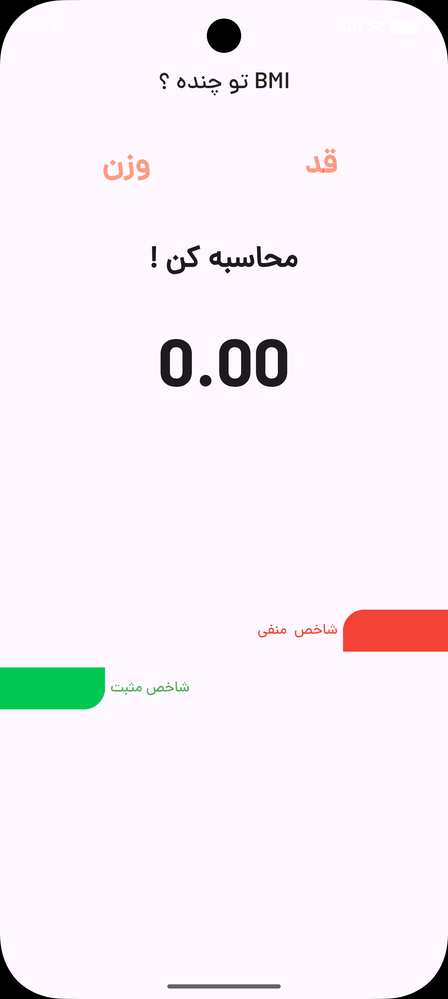
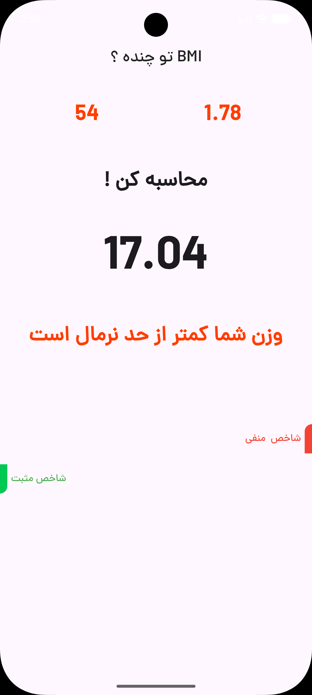
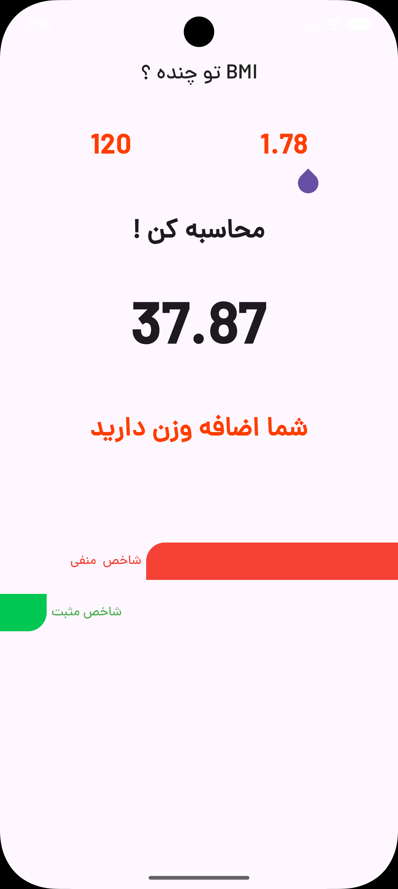

[English](README.md) | [فارسی](README.fa.md)

# BMI Calculator

A small Flutter app with a Persian interface for calculating body mass index. Enter your weight and height, tap calculate, and see your BMI alongside a short weight-status message and two colored indicators.

[](https://flutter.dev/)
[](pubspec.yaml)
[](LICENSE)

The package is named `bmi_calculator`, with version `1.0.0+1`. The repository includes Android, web, and Windows runners; iOS, macOS, and Linux runners are not included.

## Screenshots

| Calculator | Underweight | Normal weight | Overweight |
| :---: | :---: | :---: | :---: |
|  |  |  |  |

These are the existing images in `assets/screenshots/`. The underweight image keeps its original filename, `Malnutrition.png`; the app itself reports that the weight is below the normal range. Screenshots are documentation assets, not bundled application images.

## Key features

- Weight and height entry on a single screen, with a numeric keyboard request.
- BMI calculation shown to two decimal places.
- Persian result messages for underweight, normal weight, and overweight.
- Red and green indicator bars whose widths change with the result.
- A bundled `dana` font, shared color constants, and a scrollable Material UI.
- Local calculation with no account, backend, network requests, or stored calculation history.

## Using the calculator

Enter weight in **kilograms** and height in **meters**. For example, enter `75` and `1.78`, then tap «محاسبه کن». The result is `23.67`. Height is used directly in the formula, so enter `1.78`, not `178`.

```text
BMI = weight_kg / (height_m * height_m)
```

The current code uses these ranges:

- Below `18.5`: underweight.
- From `18.5` through `25`, including both endpoints: normal weight.
- Above `25`: overweight.

These describe the app's implementation, not a full clinical classification. There is no separate obesity category, and BMI alone is not a medical diagnosis.

Input validation is not implemented yet. Use positive numbers, Latin digits (`0–9`), and a dot for decimals. Empty or nonnumeric input can throw a parsing error; zero and negative values are not rejected. The fields do not show unit labels or convert centimeters to meters.

## Tech stack and architecture

This is a small, screen-based Flutter project rather than Clean Architecture or MVVM. `Application` creates the `MaterialApp` and applies the font theme. `HomeScreen` owns the input controllers, calculation, result text, and indicator widths. State Management uses Flutter's `StatefulWidget` and `setState`; there is no BLoC, Provider, or Riverpod layer.

```text
lib/
├── main.dart                         # App entry point and theme
├── constants/
│   └── constants.dart                # Shared colors built with HexColor
├── screens/
│   └── home_screen.dart              # Inputs, BMI logic, and local state
└── widgets/
    ├── background_shape_left.dart    # Green positive indicator
    └── background_shape_right.dart   # Red negative indicator

assets/
├── fonts/
│   └── dm.ttf                        # Registered as the dana font family
└── screenshots/                      # README screenshots

test/
└── widget_test.dart                   # Original counter-template test
```

### Dependencies

The following are the declared constraints in `pubspec.yaml`; `pubspec.lock` records the resolved versions.

- **`flutter` (SDK):** Material widgets, themes, and the application runtime.
- **`hexcolor: ^3.1.3`:** converts hex strings into the shared UI colors.
- **`cupertino_icons: ^1.0.8`:** available icon set; the current calculator screen does not use it.
- **`flutter_test` (SDK, development):** widget-testing utilities.
- **`flutter_lints: ^6.0.0` (development):** lint rules enabled through `analysis_options.yaml`.

There are no networking, local-storage, external state-management, or code-generation packages.

## Getting started

### 1. Prepare Flutter

Install the [Flutter SDK](https://docs.flutter.dev/install) and add its `bin` directory to your `PATH`. The project requires Dart **`^3.12.0`**, meaning `>=3.12.0 <4.0.0`. Choose a Flutter SDK that bundles a compatible Dart version; Flutter includes Dart, so a separate Dart installation is not needed.

```bash
flutter --version
flutter doctor
```

For Android, set up the Android SDK and an emulator or connected device. For web, use Chrome. For Windows desktop, install Visual Studio with the **Desktop development with C++** workload. The available runners do not imply that every platform has been tested.

### 2. Clone the repository

```bash
git clone https://github.com/mehrshadkhv/BMI_Calculator.git
cd BMI_Calculator
```

If you already have the project locally, open a terminal in its root directory instead.

### 3. Install dependencies

```bash
flutter pub get
```

The font is already declared in `pubspec.yaml`. There is no `build_runner` dependency and no code-generation step. No API keys, environment files, or backend setup are required.

### 4. Run the app

```bash
flutter devices
flutter run
```

To select a particular target, pass its device ID:

```bash
flutter run -d <device-id>
```

For the included web or Windows runners:

```bash
flutter run -d chrome
flutter run -d windows
```

## Development checks

```bash
flutter analyze
flutter test
```

`test/widget_test.dart` is still the generated counter smoke test. It expects counter text and an add button that this calculator does not have, so it needs to be replaced before the test suite can be treated as calculator coverage. There are currently no BMI-specific tests.

## GitHub language statistics

The root [`.gitattributes`](.gitattributes) excludes Android, iOS, web, Linux, macOS, and Windows boilerplate from GitHub Linguist's language statistics. It also marks `*.g.dart` and `*.freezed.dart` as generated. This keeps the statistics focused on handwritten Dart without removing any platform files or changing how the app builds. GitHub applies the attributes after they are committed and pushed, when it recalculates the repository's statistics.

## License

Licensed under the [MIT License](LICENSE). Copyright © 2026 Mehrshad Khodavirdizadeh.
